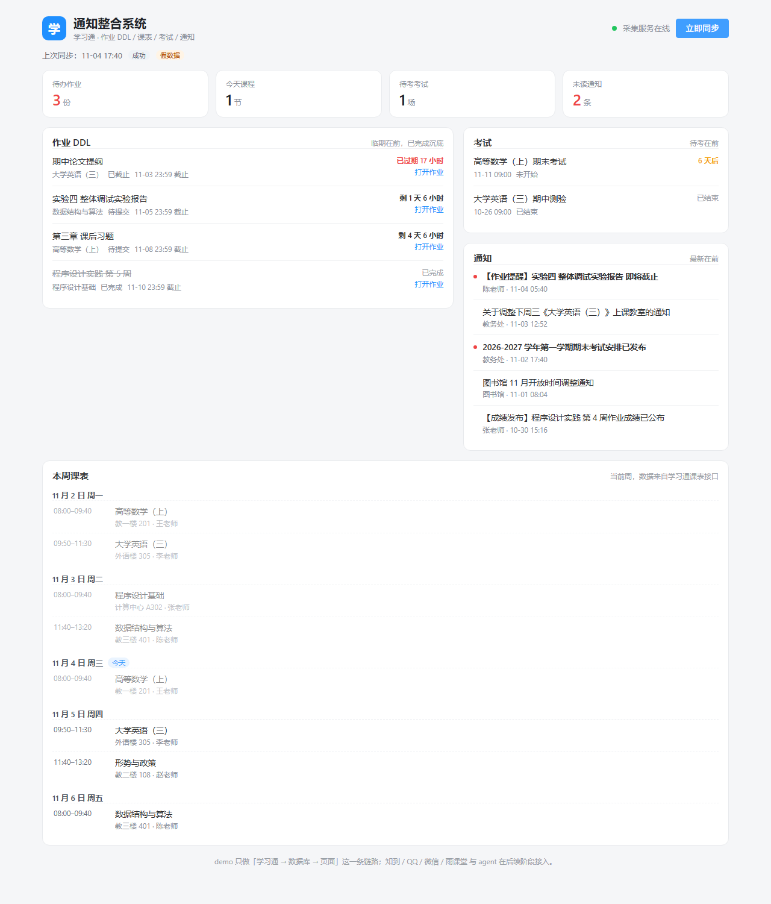

# 通知整合系统

把学习通的**作业 DDL / 课表 / 考试 / 通知**汇到一页里的本地小工具。

三段式结构，每段都能单独跑、单独换：

```
浏览器 (Vue3 + Vite :5273)
   │  /api/*        →  Java 后端 :8080    业务数据
   │  /collector/*  →  采集服务 :8801    登录 / 账号 / 触发采集
   ▼
Java 后端 (Spring Boot)  ──HTTP──▶  采集服务 (FastAPI)  ──▶  学习通
   │                                    │
   ▼                                    ▼
MySQL / H2                     session_cookies.json
                               data/last_sync.json
```

**边界**：对学习通**只读**——不签到、不刷课、不答题、不交作业。本阶段只接学习通一个数据源，不接 agent、通知推送、知到 / QQ / 微信 / 雨课堂。

---

## 目录结构

```
chaoxing-InfoGetting/
├── collector/                 Python 采集服务（:8801）
│   ├── chaoxing/
│   │   ├── client.py          学习通协议层：登录、会话、课程/作业/考试/通知接口
│   │   ├── collect.py         把接口数据组装成统一 JSON
│   │   └── mock.py            假数据（不连学习通也能跑通全链路）
│   ├── main.py                FastAPI 路由 + 同步状态机
│   ├── security.py            AES-256-GCM 加解密、手机号脱敏、文件权限收紧
│   ├── probe.py               抓不到数据时 dump 原始响应用
│   ├── config.example.json    配置模板（真实配置是 config.json，不进仓库）
│   └── requirements.txt
├── backend/                   Java 后端（:8080）
│   ├── src/main/java/com/example/notify/
│   │   ├── collector/         调采集服务的 HTTP 客户端
│   │   ├── sync/              同步编排、并发锁、同步日志
│   │   ├── item/              统一事件表读写（幂等 upsert）
│   │   └── web/               REST 接口
│   └── src/main/resources/
│       ├── application.yml          MySQL 档（默认）
│       ├── application-h2.yml       零配置档，数据落在 ./data/notifydb.mv.db
│       └── db/schema.sql            建表脚本，IF NOT EXISTS，可重复执行
├── frontend/                  Vue3 + Element Plus（:5273）
│   ├── src/App.vue            单页：概览卡片 + 作业/考试/通知三栏 + 本周课表 + 登录弹窗
│   └── vite.config.js         /api → 8080，/collector → 8801
└── docs/screenshot.png        假数据界面截图
```

---

## 快速开始

前置：**Python 3.10+**、**JDK 21**、**Node 20+**（Vite 8 的要求）。三个终端分别跑：

### 1. 采集服务（:8801）

```powershell
cd collector
python -m pip install -r requirements.txt
python -m uvicorn main:app --host 127.0.0.1 --port 8801
```

### 2. Java 后端（:8080）

H2 档不需要装 MySQL：

```powershell
cd backend
mvn spring-boot:run "-Dspring-boot.run.profiles=h2"
```

也可以直接用打好的 jar（启动更快）：

```powershell
cd backend
java -jar target\notify-demo-0.1.0.jar --spring.profiles.active=h2
```

> 机器上装了多个 JDK 时，先把 `JAVA_HOME` 指向 JDK 21，否则 Spring Boot 4 起不来。

### 3. 前端（:5273）

```powershell
cd frontend
npm install
npm run dev
```

打开 <http://127.0.0.1:5273>。界面长这样（假数据模式）：



首次启动时 `collector/config.json` 不存在会自动生成一份，默认 `mock: true`（假数据、不需要登录），所以直接点「立即同步」就能看到完整界面。要接真实账号，把 `mock` 改成 `false` 再登录。

---

## 登录与同步

**推荐在页面上登录**（右上角「登录学习通」）：

- 填手机号 + 密码，可选「记住密码」，点「登录并同步」，登录成功后自动触发一轮同步；
- 密码只发给本机采集服务（`127.0.0.1:8801`），不经过 Java 后端，也不进浏览器之外的地方；
- 已登录时弹窗里多一个「退出登录」，会清掉 cookie 和已保存的密码；
- 换账号也在这里换，不用改文件。带 `?login=1` 打开页面会直接弹出登录框。

**同步是异步的**：点「立即同步」只是触发，页面每 2 秒轮询进度；真实账号一轮通常 1~2 分钟（要逐门课拉作业列表、再逐份未交作业拉详情页才能拿到截止时间）。

页面上有两个容易混淆的动作：

| 动作 | 行为 |
|---|---|
| 「重新读取」/ 每 20 秒自动刷新 | 只重读数据库，不打学习通 |
| 「立即同步」 | 触发采集服务去学习通拉新数据 |

---

## 配置

`collector/config.json`（本地文件，已 gitignore）：

| 字段 | 默认 | 说明 |
|---|---|---|
| `phone` | `""` | 学习通手机号（明文，用来判断 cookie 属于谁） |
| `password` | `""` | **恒为空字符串**；老版本留下的明文会在启动时自动迁移成密文并清空 |
| `password_enc` | `""` | 勾「记住密码」才有值，AES-256-GCM 密文 |
| `remember` | `false` | 是否记住密码 |
| `mock` | `true` | `true` = 用 `mock.py` 假数据，不登录也能看页面 |
| `throttle` | `0.5` | 每次请求之间的间隔（秒），别调太小，容易触发风控 |
| `notice_limit` | `40` | 一次最多取多少条通知 |
| `with_details` | `true` | 是否逐份作业拉详情（拿到截止时间，但慢） |

环境变量优先级高于 `config.json`：

| 变量 | 作用 |
|---|---|
| `CHAOXING_PHONE` / `CHAOXING_PASSWORD` | 直接提供凭据，适合 CI 或临时调试 |
| `MYSQL_USER` / `MYSQL_PASSWORD` | 后端 MySQL 账号密码 |
| `DEMO_AUTO_SYNC` | `true` 开启定时同步（默认 `false`，cron 为每 30 分钟一次） |
| `DEMO_REDIS` | `true` 启用 Redis 做同步锁与概览缓存；没装 Redis 就保持 `false`，会自动降级为进程内实现 |

### 假数据模式

```json
{ "mock": true }
```

不需要账号密码，直接点「立即同步」就能看到完整界面（作业/课表/考试/通知都有）。假数据按当天日期动态生成，所以「剩 1 天」「已过期 17 小时」这类文案会随时间变。

⚠️ **假数据和真实数据互斥**：切换模式时，另一种模式的历史行会被先删掉再写入，不会混在一起。

---

## 接口

### 采集服务（FastAPI，:8801）

| 方法 | 路径 | 说明 |
|---|---|---|
| GET | `/api/health` | 存活检查：`has_credentials` / `has_cookie` / `mock`，手机号脱敏 |
| GET | `/api/account` | 当前账号（脱敏）：登录状态、姓名、学校、手机号、是否记住密码 |
| GET | `/api/login/status` | 只查登录态，不触发自动登录 |
| POST | `/api/login` | `{phone, password, remember}` 登录；密码不落明文、不回显 |
| POST | `/api/logout` | 清 cookie 和 `password_enc` |
| POST | `/api/sync` | 触发一轮采集（异步，立刻返回） |
| GET | `/api/sync/status` | 采集进度 |
| GET | `/api/data` | 最近一次成功的统一 JSON（没同步过返回 404） |

### Java 后端（:8080）

| 方法 | 路径 | 说明 |
|---|---|---|
| GET | `/api/overview` | 首页概览：四类列表 + 计数 + 上次同步信息 + 是否正在同步 |
| GET | `/api/homework` | 作业列表 |
| GET | `/api/schedule` | 课程表 |
| GET | `/api/exams` | 考试列表 |
| GET | `/api/notices` | 通知列表 |
| GET | `/api/health` | 后端健康状态（含采集服务是否在线） |
| POST | `/api/sync` | 触发同步：调采集服务 → 轮询进度 → 取回数据入库 |
| GET | `/api/sync/status` | 同步状态 |

---

## 数据模型

两张表，MySQL 8 与 H2（`MODE=MySQL`）通用，建表脚本全 `IF NOT EXISTS`。

**`info_item`** —— 统一事件表，四类数据共用一张表：

| 字段 | 说明 |
|---|---|
| `source` / `item_type` / `source_id` | 联合唯一，`source_id` 用于幂等 upsert |
| `title` / `course` / `teacher` / `location` | 展示字段 |
| `deadline` / `start_time` / `end_time` | 时间字段（作业截止、上课、考试） |
| `mock` | `1` = 假数据行，切真实账号时清掉 |
| `account` | 属于哪个学习通账号（uid），换号时清掉别的账号的行 |
| `raw_json` | 采集器保留的原始字段 |

**`sync_log`** —— 每轮同步一条：`RUNNING` / `SUCCESS` / `FAILED`、四类数量、耗时、账号名、错误信息。

**幂等**：同一批数据重复同步不会产生重复行，`source_id` 命中就更新（日志里会显示「新增 0 条，更新 N 条」）。

---

## 安全设计

1. **明文密码从不落盘**。`config.json` 的 `password` 字段永远是空字符串，老版本遗留的明文会在启动时迁移成密文并清空。
2. **密钥与配置分离**。`secret.key` 是首次使用时随机生成的 32 字节密钥，`config.json` 和 `secret.key` 都做了权限收紧（Windows `icacls` 只留当前用户，Linux/macOS `chmod 600`）。只拿到 `config.json` 解不开密码。
3. **接口不回显**。`/api/account` 只返回脱敏手机号（形如 `138****0000`），任何响应里都没有密码字段。
4. **日志不打印密码**。登录过程只记录成功/失败。
5. **密码不经过 Java 后端**。浏览器 → 采集服务这条链路上完成登录，Java 只拿业务数据。
6. **随时可清**。点「退出登录」或调 `POST /api/logout`，会删掉 cookie 与 `password_enc`。

以下文件**只在本机存在，永远不要提交**（`.gitignore` 已覆盖）：

```
collector/config.json      凭据
collector/secret.key       加密密钥
collector/session_cookies.json   学习通登录态（等价于密码，泄露= 别人能登你的号）
collector/session_owner.json
collector/data/            同步快照
collector/probe_out/       登录后的页面快照（含课程、姓名）
backend/data/              H2 数据库
backend/*.log
```

---

## 打包

后端：

```powershell
cd backend
mvn -DskipTests package
java -jar target\notify-demo-0.1.0.jar --spring.profiles.active=h2
```

前端：

```powershell
cd frontend
npm run build        # 产物在 dist/
npm run preview      # 本地预览产物
```

---

## 抓不到数据时先跑 probe.py

「同步成功但作业/课表/考试都是 0」有四种可能：账号里确实没有、登录态掉了、页面结构变了、查错了入口。别猜，直接让采集层把原始响应打出来：

```powershell
cd collector
python probe.py --dump
```

输出会逐项告诉你实情，例如：

```
[1] 登录: ok=True msg=cookie 有效
    账号: 某某 @ 某某大学 (uid=000000000)
[2] 课程 4 门:
    1. 高等数学（上） | 张老师 | courseid=111111111 clazzid=222222222
    ...
[3] 课表:
    result=1  schoolYear=2026 semester=1 maxWeek=25 currentWeek=15
[4] 作业:
    《高等数学（上）》课程页 103082 字符, workEnc=有
      作业 0 份, 进度=(0, 0)
[5] 考试:  页面 6725 字符, dataTr 行数=0
[6] 通知:  取到 2 条
```

| probe 结果 | 说明 |
|---|---|
| `登录 ok=False` | 凭据或验证码问题，见下方「常见问题」 |
| `课程 0 门` | 账号或 cookie 不对，基本等于没登上 |
| `作业 0 份` 且 `workEnc=有` 且课程页很大 | 这课**确实没有作业**（列表页是「暂无作业」） |
| `workEnc=无!` | 该课程未开放作业功能（正常，会记进 `errors`） |
| `课表 lessonArray 空` | 学习通课表里没录数据（多数学校课表在教务系统，学习通要手动绑定） |
| `dataTr 行数=0` | 没有考试安排 |

---

## 常见问题

**登录失败（账号密码错误或需要验证码）**

学习通对异地/新设备登录会要求验证码或二次验证，脚本过不了。处理办法：用浏览器正常登录一次 <https://i.chaoxing.com> 把验证码过掉，然后从开发者工具 Application → Cookies 里把 `passport2.chaoxing.com` 域下的条目抄成一个 JSON 对象，存成 `collector/session_cookies.json`，重启采集服务即可：

```json
{ "_uid": "123456", "_d": "...", "UID": "...", "vc3": "..." }
```

键名照抄 Chrome 里显示的 name，值照抄 value。建议在**自己电脑自己的网络**上跑，机房或云服务器 IP 容易被风控挡掉。

**页面显示「采集服务未启动」**

`:8801` 没起来，或者 `demo.collector.base-url` 配置的不是 `http://127.0.0.1:8801`。先访问 <http://127.0.0.1:8801/api/health> 确认。

**换账号后数据还是旧的**

同步信息行会显示「库里数据属于 X，点立即同步按当前账号重拉」。点一次同步即可，旧账号的行会被清掉（按 `info_item.account` 区分）。

**端口被占用**

`5273` 是前端固定端口（`strictPort`，被占用会直接报错而不是换端口），`8080` 是后端，`8801` 是采集服务。先用 `Get-NetTCPConnection -LocalPort 5273` 查一下谁占着。

---

## 技术栈

- **Java 21** · Spring Boot 4.1.2 · MyBatis-Plus 3.5.18 · MySQL 8 / H2
- **Vue 3** + Vite 8 + Element Plus
- **Python 3.10+** · FastAPI · uvicorn · requests · pycryptodome（AES-256-GCM）

## 参考

协议层移植自 `xuexitong-cli`（MIT）的 `xuexitong_mcp/client.py`，裁掉了 MCP server / CLI / 桌面小窗，只保留登录、会话与四类只读接口。

## 后续

- 接入更多数据源：知到、雨课堂、QQ / 微信通知
- 通知推送（邮件 / 桌面通知）
- MySQL 档补自动化测试与索引优化（当前 H2 档用于零配置试跑）
